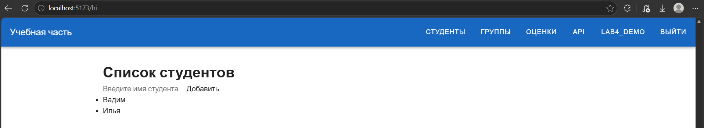
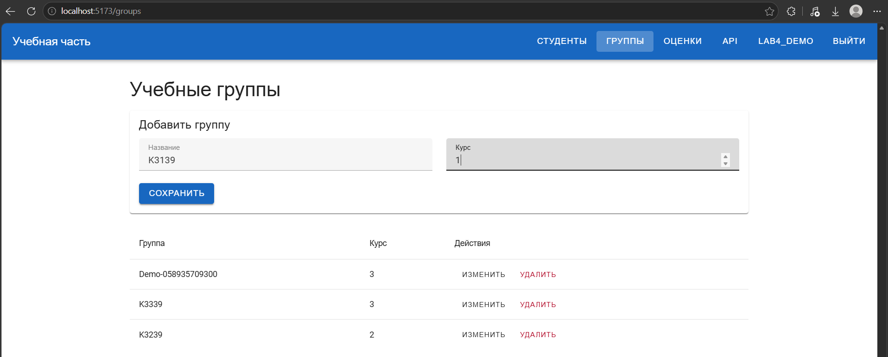
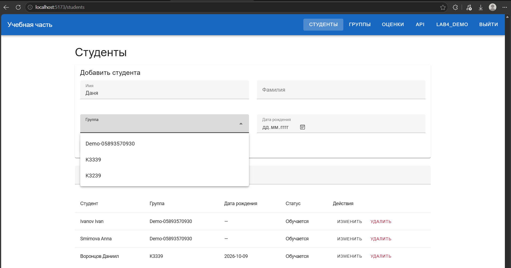
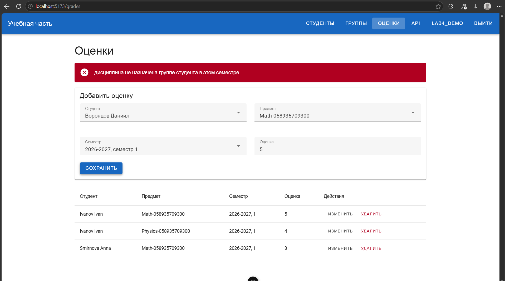
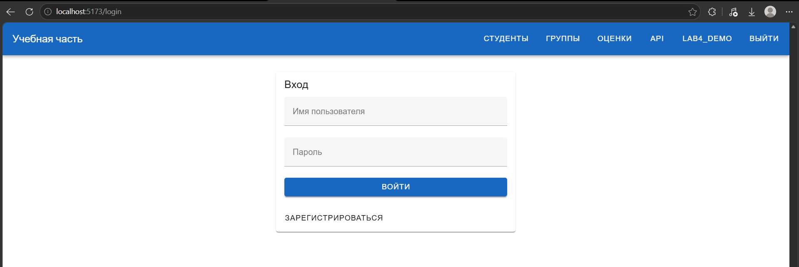
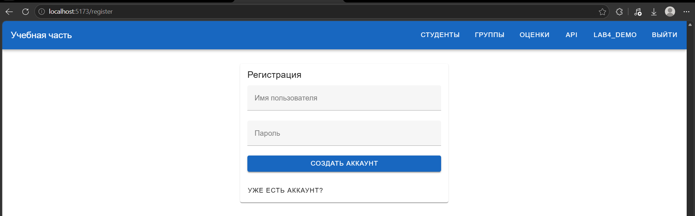
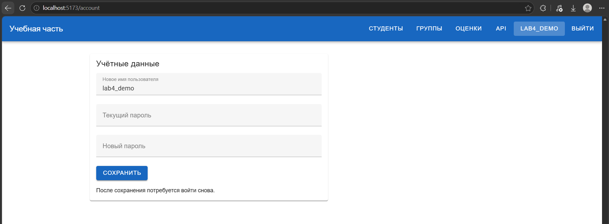
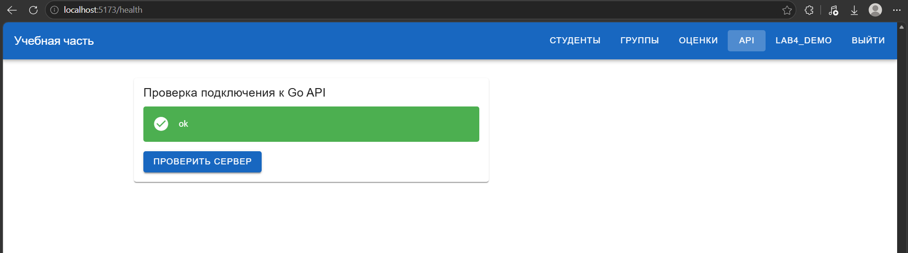
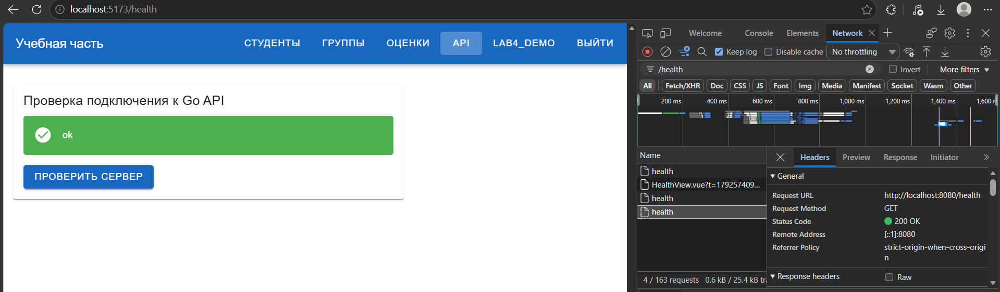
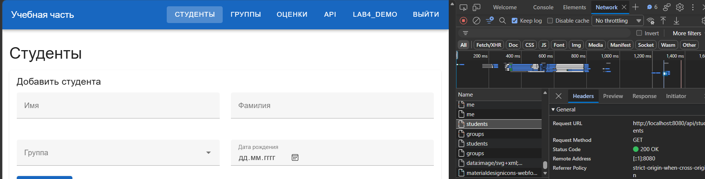

# Лабораторная работа №4

## Вариант 12. Учебная часть колледжа

В четвёртой работе сделана клиентская часть для API из ЛР3. Приложение написано на Vue 3. Для переходов между страницами используется Vue Router, для запросов Axios, для оформления Vuetify.

---

## Task 1. Проект

Клиент находится в `laboratory_work_4/frontend`. Основные файлы:

```text
frontend/src/
├── components/
│   ├── Hello.vue
│   ├── StudentForm.vue
│   └── StudentList.vue
├── views/
│   ├── AuthView.vue
│   ├── AccountView.vue
│   ├── StudentsView.vue
│   ├── GroupsView.vue
│   ├── GradesView.vue
│   └── HealthView.vue
├── router/index.js
├── services/api.js
├── services/auth.js
├── App.vue
└── main.js
```

`App.vue` содержит верхнее меню и место для страниц (`RouterView`). Компоненты студентов вынесены отдельно от страницы списка.

| Адрес | Страница |
| --- | --- |
| `/hi` | Первый пример компонента Vue |
| `/register`, `/login` | Регистрация и вход |
| `/students` | Студенты |
| `/groups` | Группы |
| `/grades` | Оценки |
| `/account` | Изменение учётных данных |
| `/health` | Проверка сервера |

---

## Практика 4.2. Vue.js

Сначала сделал компонент `Hello.vue`: поле ввода и список имён. Для списка используется `v-for`, для поля `v-model`. Затем сделал `StudentForm.vue` и `StudentList.vue`. Форма передаёт данные странице через событие `save`, а страница загружает студентов и группы из API.

Пример загрузки данных в `StudentsView.vue`:

```js
const [studentsResponse, groupsResponse] = await Promise.all([
  api.get('/api/students'),
  api.get('/api/groups')
])
students.value = studentsResponse.data
groups.value = groupsResponse.data
```

Для студентов доступны добавление, изменение, удаление и поиск по имени или фамилии. Группы и оценки также можно просматривать и изменять. При выставлении оценки студент, предмет и семестр выбираются из данных сервера.

Первый компонент со списком имён:



Форма и таблица учебных групп:



На странице студентов группа выбирается из списка, полученного от API:



Сервер проверяет связь оценки с назначенной группе дисциплиной. На снимке видны уже сохранённые оценки и сообщение об ошибке при попытке добавить оценку по неподходящей дисциплине:



### Авторизация

При регистрации отправляются имя пользователя и пароль. После входа сервер возвращает `auth_token`. Axios добавляет его к запросам в заголовке `Authorization: Token ...`. Страницы с учебными данными открываются после входа.

На странице профиля можно изменить имя пользователя и пароль. Для этого в Go API добавлен `PATCH /api/auth/users/me` с проверкой текущего пароля. После изменения токены пользователя удаляются, поэтому нужно войти снова.

Формы входа и регистрации:





Форма изменения учётных данных:



---

## Практика 4.3. CORS и запросы к серверу

Vue работает на `http://localhost:5173`, а Go API на `http://localhost:8080`. Чтобы браузер разрешал запросы между ними, в `laboratory_work_3/cmd/server/main.go` добавлена обработка CORS:

```go
w.Header().Set("Access-Control-Allow-Origin", "http://localhost:5173")
w.Header().Set("Access-Control-Allow-Methods", "GET, POST, PUT, PATCH, DELETE, OPTIONS")
w.Header().Set("Access-Control-Allow-Headers", "Content-Type, Authorization")

if r.Method == http.MethodOptions {
    w.WriteHeader(http.StatusNoContent)
    return
}
```

Проверка на странице `/health` выполняет `GET /health`. Сервер отвечает:

```json
{"status":"ok"}
```

В ответе на запрос с источника Vue есть заголовок `Access-Control-Allow-Origin: http://localhost:5173`. После входа также успешно загружаются списки студентов, групп и оценок.

Страница проверки соединения показывает ответ сервера:



Во вкладке Network запрос `/health` завершается со статусом `200 OK`:



После входа запрос списка студентов также возвращает `200 OK`:



---

## Результат

Клиент обращается к существующим маршрутам ЛР3. Сборка Vue и проверка ESLint проходят. Отклик `/health` и загрузка списков из Go API проверены на запущенном сервере.
